<p align="center">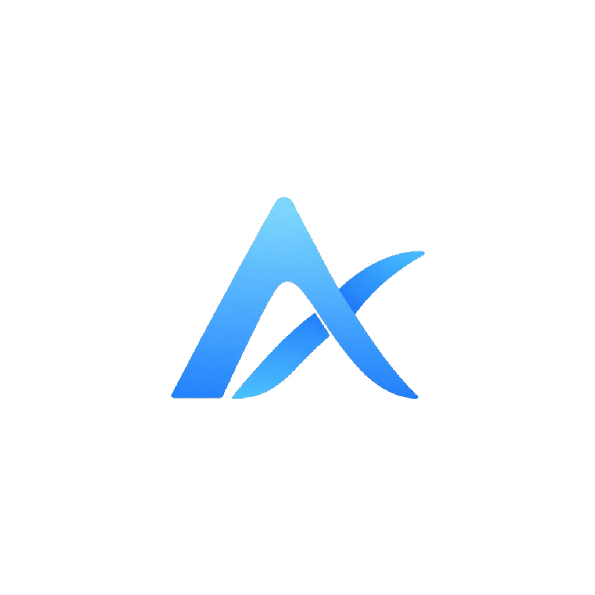</p>
<h1 align="center">AporiaX</h1>
<p align="center"><a href="README.md">简体中文</a> · <strong>English</strong></p>
<p align="center"><em>Every problem begins with an aporia.</em></p>
<p align="center">
  <a href="https://aporiax.cloud"><strong>Official website · aporiax.cloud</strong></a> ·
  <a href="https://github.com/CaptainLand/AporiaX/releases/tag/v1.0.0">Download 1.0.0 stable</a> ·
  <a href="https://captainland.github.io/AporiaX_web/guide/">User guide (Chinese)</a>
</p>
<p align="center">
  <a href="https://github.com/CaptainLand/AporiaX/releases/tag/v1.0.0"></a>
  <a href="https://github.com/CaptainLand/AporiaX/releases"></a>
  <a href="LICENSE"></a>
</p>

AporiaX is a local-first Windows desktop agent for coding and Office work. It brings conversations, files, a terminal, browser, Git and specialist agents into one workbench. Review actions and file changes, inspect results, and use Anchor checkpoints to revert changes in your authorized workspace.

## 1.0.0 stable

- **Unified workbench:** refined light/dark themes, flat conversation and Witness surfaces, and focused sidebar tools for documents, code, Git, terminals and side chat.
- **Specialist agents:** configure roles, models, reasoning effort, budgets and permitted capabilities. Creating, modifying or deleting a reusable custom role through the main agent always requires user confirmation. Built-in roles cannot be deleted.
- **Agent office and messages:** a movable, zoomable 2.5D office with six characters, private chats and a team group. Chat does not silently execute work; a work request must be confirmed and handed to the main agent.
- **Account and personalization:** Cloud request history, token totals, a daily usage calendar and selectable team avatars. Experimental custom themes support basic colors and background images, including AI-designed candidates that you choose to apply.
- **Clear controls:** permissions and approvals live in Settings. Outside-workspace file access is off by default. Roles, Skills and MCP cannot exceed parent-task authority.
- **Safer installation and updates:** the new installer supports legacy-client directory updates. Stable interactive installation can organize confirmed old copies into recoverable backups and automatically appends an `AporiaX` folder to the selected parent directory.

[Release notes](docs/RELEASE_NOTES_v1.0.0.md) · [Installation organizer (Chinese)](docs/INSTALLATION_ORGANIZER.zh-CN.md) · [Changelog](CHANGELOG.md)

## Download

| Windows x64 | Download |
| --- | --- |
| Installer (recommended) | [AporiaX-Setup-1.0.0-x64.exe](https://github.com/CaptainLand/AporiaX/releases/download/v1.0.0/AporiaX-Setup-1.0.0-x64.exe) |
| Portable | [AporiaX-Portable-1.0.0-x64.exe](https://github.com/CaptainLand/AporiaX/releases/download/v1.0.0/AporiaX-Portable-1.0.0-x64.exe) |
| Checksums | [SHA256SUMS-1.0.0.txt](https://github.com/CaptainLand/AporiaX/releases/download/v1.0.0/SHA256SUMS-1.0.0.txt) |

Install, choose a workspace, and sign in for Aporia Cloud or add your own API/local model in Settings. Describe your goal and inspect the actions and deliverables. Project knowledge is opt-in per task.

Installed copies can check for updates in Settings → About, download and restart to install. Differential downloads depend on cached packages and server support; full downloads are the fallback. Portable users replace the package manually. **Windows packages are currently unsigned.** Closing the window may only hide it to the tray; exit old copies through the tray before installation or organization.

The organizer only moves explicitly confirmed, recognized program files into recoverable backups. It does not delete conversations, credentials, workspaces or mixed-in documents, scan every drive, or guarantee discovery of arbitrary copied folders. Silent and portable installations do not automatically organize copies.

## Screenshots

<table>
  <tr>
    <td width="50%"><a href="docs/assets/dialogue.png">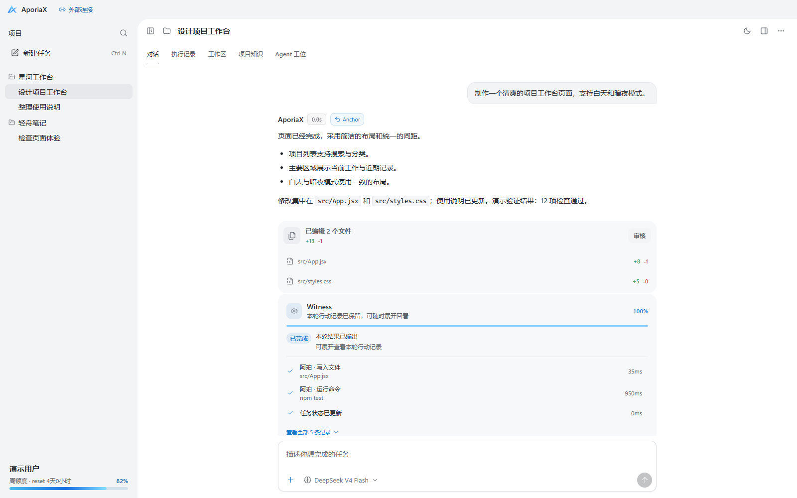</a></td>
    <td width="50%"><a href="docs/assets/agent-office.png">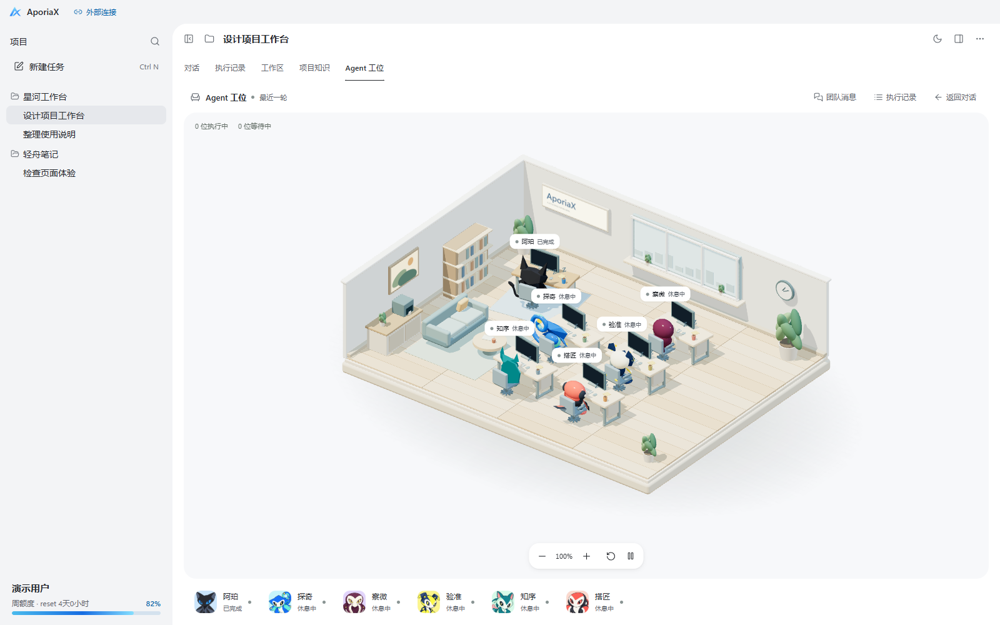</a></td>
  </tr>
  <tr><td align="center">Conversation</td><td align="center">Agent office</td></tr>
  <tr>
    <td>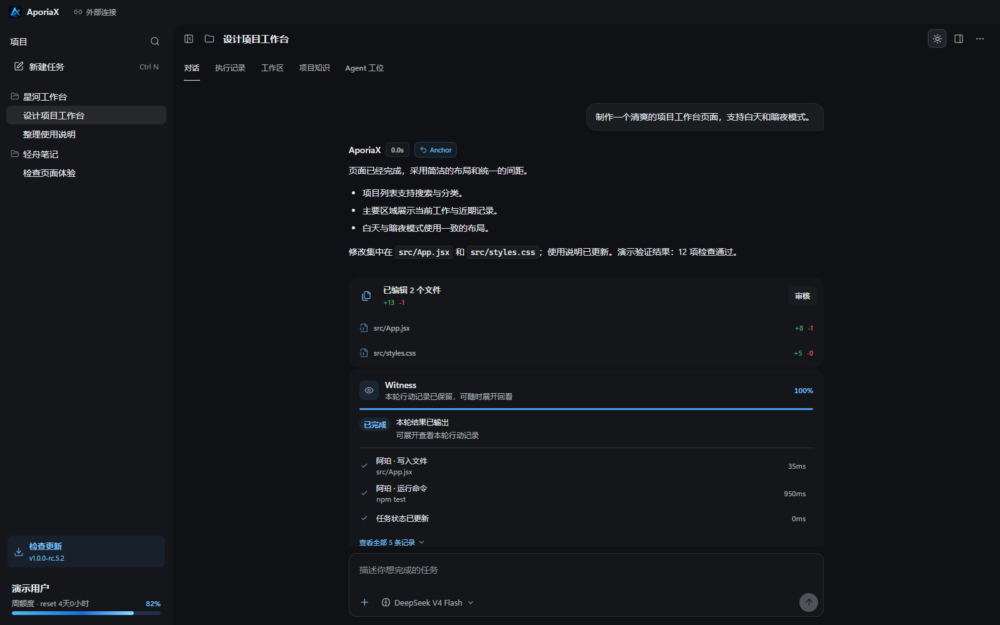</td>
    <td>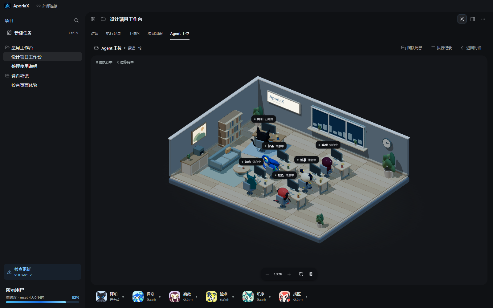</td>
  </tr>
  <tr><td align="center">Dark workbench</td><td align="center">Dark office</td></tr>
  <tr>
    <td>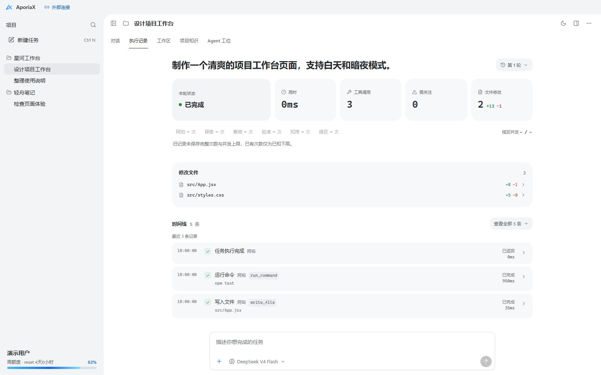</td>
    <td>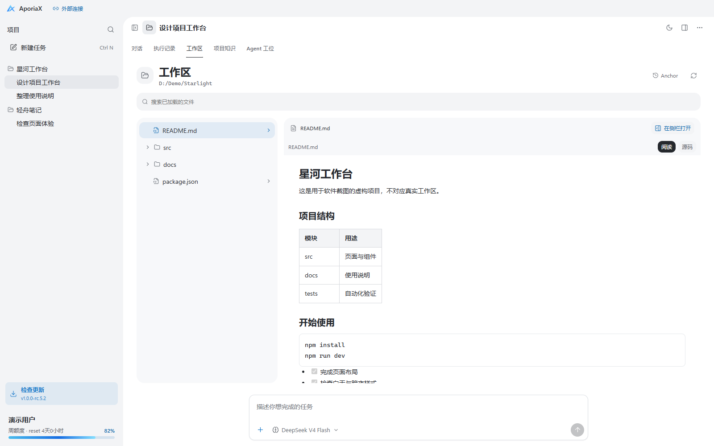</td>
  </tr>
  <tr><td align="center">Execution records</td><td align="center">Workspace</td></tr>
  <tr>
    <td>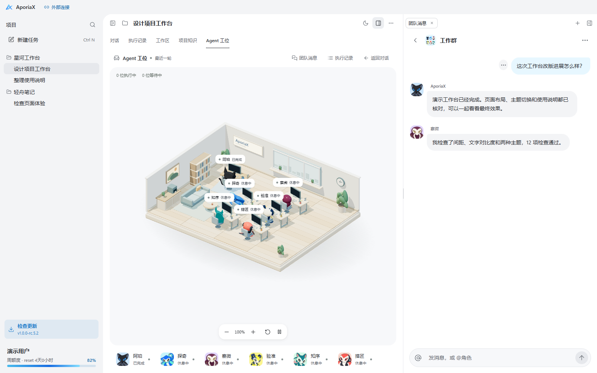</td>
    <td>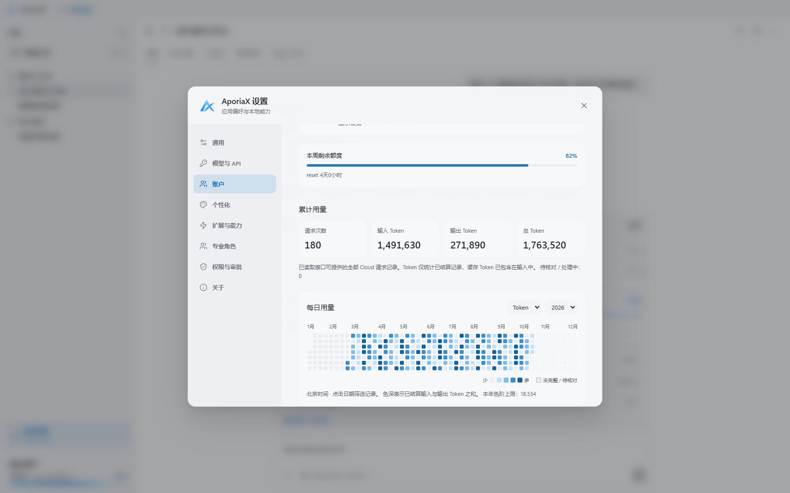</td>
  </tr>
  <tr><td align="center">Team messages</td><td align="center">Account usage</td></tr>
  <tr>
    <td>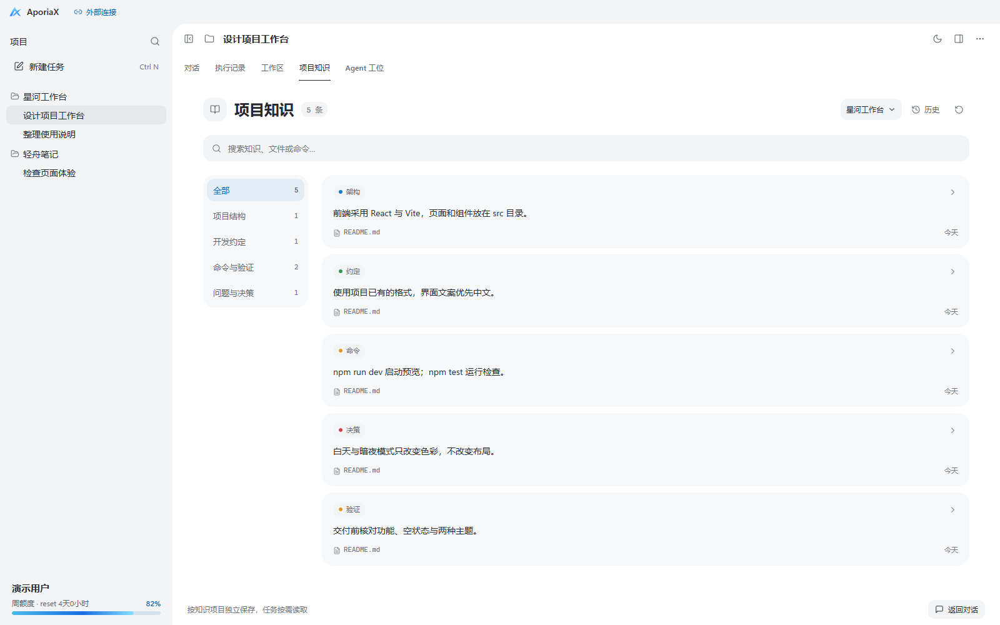</td>
    <td>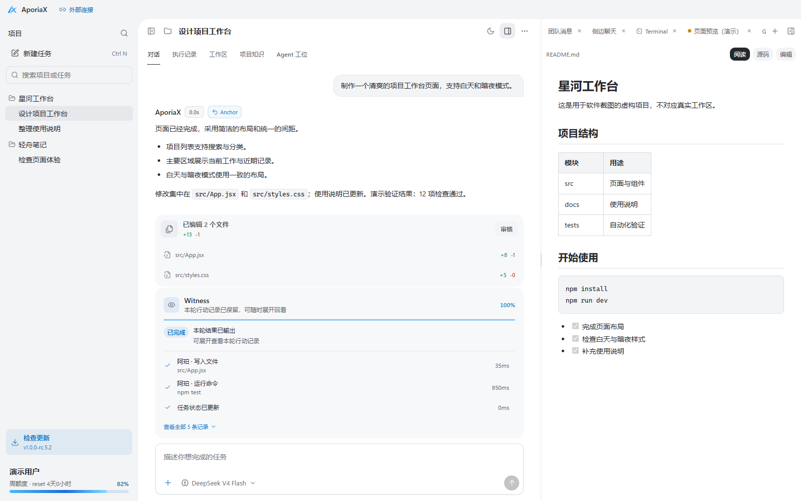</td>
  </tr>
  <tr><td align="center">Project knowledge</td><td align="center">Documents</td></tr>
  <tr>
    <td>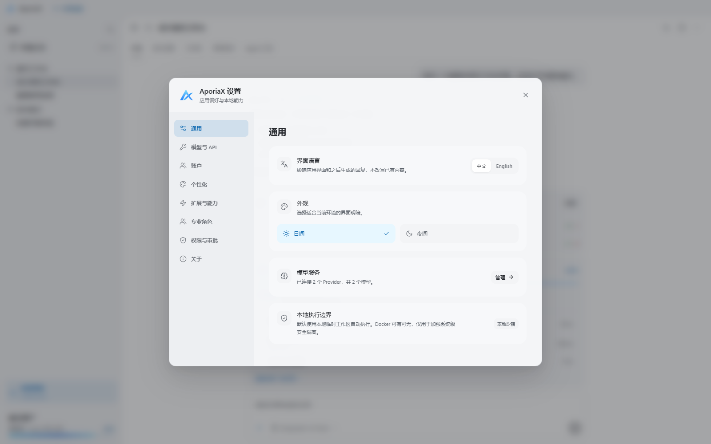</td>
    <td>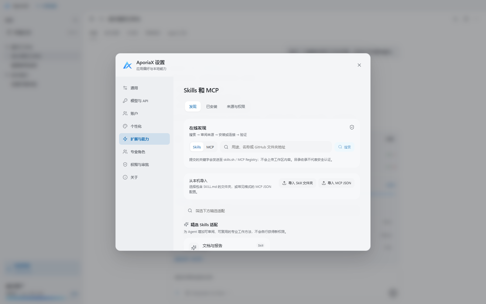</td>
  </tr>
  <tr><td align="center">Settings</td><td align="center">Extensions</td></tr>
</table>

Captured on 2026-10-15 using fictional accounts, workspaces, conversations and usage records. No real workspace is shown. The browser sidebar demonstration shows its interface shell only.

## Capabilities and boundaries

- File reading, ripgrep search, Unified Patch, code/document previews, Office generation and Git workflows, including side-by-side conflict editing and read-only PR information.
- AporiaX coordinates Scout (exploration), Sentry (review), Checko (verification), Forge (building) and Index (knowledge). Writable workers stay within controlled scopes; the main agent accepts changes after conflict checks. Builders do not independently run shell commands or publish.
- Skills, MCP and persistent LSP tools extend capabilities without bypassing permissions. Workspace instructions such as `AGENTS.md` and `APORIAX.md` are recognized.
- Project knowledge supports multiple projects per workspace, per-task opt-in, on-demand retrieval, sources and revisions.
- Direct / Safe / Isolated execution and three approval modes. A temporary workspace is not an OS sandbox; Isolated requires working Docker and does not silently downgrade.
- Action receipts, file diffs, Witness and Anchor remain inspectable. A normal reply does not certify that every goal was verified; read the result and any remaining limitations.
- Temporary network failures can wait for recovery. Unknown side effects are not blindly replayed. Exit/power loss does not guarantee automatic continuation, and retries may incur additional model costs.

### Privacy and external connections

Projects and conversations are stored locally by default. The retired mobile companion's background project sync, remote file browsing/upload and remote-task channel are removed. Signing in does not upload your entire workspace.

Local-first does not make cloud models offline: relevant prompts, conversation excerpts, file contents or attachments are sent to the selected model provider. Authorized network tools, MCP and Git pushes may also transmit data. API keys are managed and encrypted in the main process, not returned to the renderer. See [SECURITY.md](SECURITY.md).

The opt-in local HTTP API, MCP stdio and CLI bridge allow other harnesses to use explicitly selected workspaces, providers and limits, with per-client revocation and desktop-managed approval. Outside-workspace access is off by default in Settings → Permissions and approvals; enabling it does not grant administrator privileges or override read-only and sensitive-file protections.

[Local control guide](docs/LOCAL_CONTROL.md) · [Agent office](docs/agent-office.md) · [Team messages](docs/team-messages.md)

## Run from source

Requires Node.js 22.12.0 or later; Docker is only required for Isolated mode.

```powershell
git clone https://github.com/CaptainLand/AporiaX.git
cd AporiaX
npm install
npm run dev
```

```powershell
npm run build
npm run dist:win
npm run test:audit-suite
```

Do not commit real credentials, profiles, conversations or logs. Read [CONTRIBUTING.md](CONTRIBUTING.md) before contributing.

## License

[AporiaX Source Available License 1.0](LICENSE), © 2026 CaptainLand and respective rights holders. Personal/internal use, modifications, free forks and commercial use of independent work products are permitted. Selling original or rebranded copies, paid unlocking and paid access to the software's functionality require written authorization. Modified versions must be identified as unofficial. This is not an OSI open-source license.

Historical MIT grants and third-party licenses are not revoked. RC5.2 and earlier copies already published under MIT keep their original permissions. See [NOTICE](licenses/NOTICE.txt) and [legacy MIT](licenses/LEGACY-MIT.txt). Contact the maintainer through [GitHub Issues](https://github.com/CaptainLand/AporiaX/issues) for commercial licensing.
